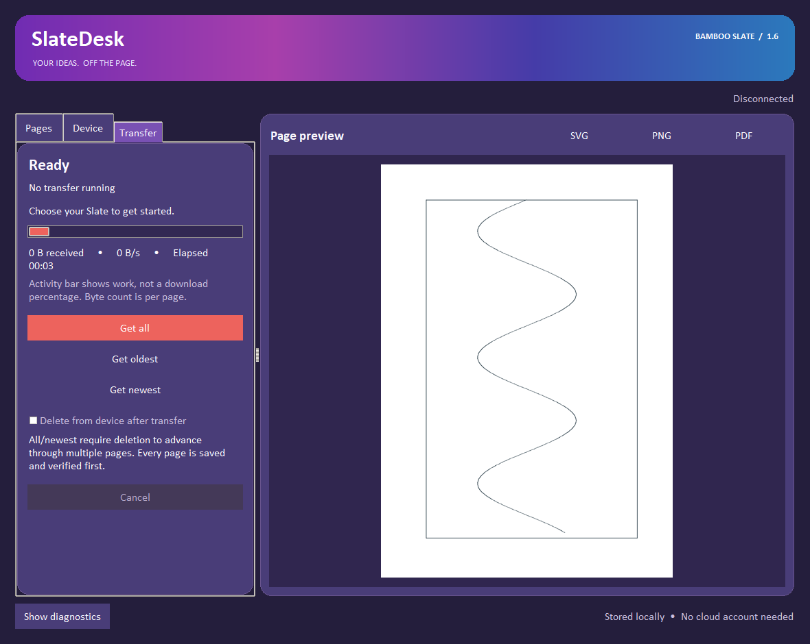

# SlateDesk

**A Windows 11 desktop companion for Wacom Bamboo Slate, based on the [Tuhi project](https://github.com/tuhiproject/tuhi).**

Download stored handwritten pages, preview them in portrait, and export SVG, PNG or PDF without Inkspace, Linux, WSL or a cloud account.

[Download Windows app](https://github.com/masterjobberman/SlateDesk/releases/latest) · [Getting started](#getting-started) · [Tuhi attribution](UPSTREAM.md) · [Feature comparison](docs/tuhi-comparison.md)



*Screenshot shows a synthetic sample, not a real downloaded drawing.*

## Download

**[Download the full Windows build](https://github.com/masterjobberman/SlateDesk/releases/download/v1.6.0/SlateDesk-1.6-Windows-x64.zip)** · [Latest release](https://github.com/masterjobberman/SlateDesk/releases/latest)

The complete portable and source ZIPs are also versioned in [`releases/v1.6.0`](releases/v1.6.0). In a development checkout with the portable build installed, launch `dist/SlateDesk/SlateDesk.exe`. To install the versioned portable bundle locally, extract `releases/v1.6.0/SlateDesk-1.6-Windows-x64.zip` into `dist`.

Get **SlateDesk-1.6-Windows-x64.zip** from [Releases](https://github.com/masterjobberman/SlateDesk/releases). Extract the whole ZIP and open `SlateDesk/SlateDesk.exe`. Keep the `_internal` folder beside the EXE. Python is bundled; no installation or administrator access is required by the application.

This is an unsigned community application. It is not an official Wacom product or an official Tuhi Windows release. Windows 11 x64 and a Bluetooth LE adapter are required. Other architectures and Windows versions have not been validated.

## Features

- Remembers your Slate registration and lists devices already paired in Windows.
- **Get oldest**, **Get all** and **Get newest**, with an explicit deletion option.
- Live received-byte count, recent speed, elapsed time, page counts and last-packet age.
- Connection, authorisation, decoding, saving, verification and deletion stages.
- Safe cancellation and stalled-transfer messages.
- Large portrait preview, page library, purple/blue theme and resizable sidebar.
- SVG, PNG and vector PDF exports; raw ink and decoded JSON kept locally.

## Important: how page selection works

The implemented Tuhi protocol exposes the **oldest stored page only**. Advancing to later pages requires removing the oldest page from the Slate.

| Action | Delete unchecked | Delete checked |
|---|---|---|
| Get oldest | Copy the oldest page and leave it on the Slate | Save and verify the oldest page, then remove it |
| Get all | Works if only one page is stored; stops without transferring/deleting if several are stored | Save, verify and remove each pending page |
| Get newest | Works if only one page is stored; stops without transferring/deleting if several are stored | Save, verify and remove all pending pages, then open the last one |

**Get newest also saves the earlier pages.** It does not skip them or silently discard them. Deletion is unchecked by default and requires confirmation. Before any removal, the app checks the transfer CRC, decodes the page, writes raw ink and JSON with a filesystem flush, then reads both files back to verify them. Back up the library separately for protection against PC/disk failure.

If the connection is lost while a deletion command is already in flight, removal may have succeeded even without an acknowledgement. The verified local backup remains. Inspect your library before retrying. Destructive commands are not automatically retried.

## Getting started

1. Charge and wake the Bamboo Slate. Enable Bluetooth on the PC and close other apps connected to the Slate.
2. For first setup only, hold the Slate button until its blue light flashes. In **Device**, scan, select the Slate and choose **First setup / repair**. Press its physical button when prompted.
3. For normal subsequent use, wake the Slate, open SlateDesk and use the **Transfer** tab. The saved device is selected automatically; you do not need to register each time.
4. Start with **Get oldest**, leaving deletion unchecked, and inspect a small test drawing.
5. Use **Get all** or **Get newest** with deletion enabled when you are ready to move the pending pages to the PC.
6. Select a page in **Pages** and use SVG, PNG or PDF above the preview to export it.

Windows Bluetooth pairing and Wacom application registration are different. A Windows-paired Slate still needs its application identity on first setup. The optional Windows pairing checkbox is for connection/access problems. Registration with another app may replace the Slate's association and require repair in SlateDesk.

## Progress and troubleshooting

The bar indicates activity rather than a guessed percentage: upstream's reported size field is not sufficiently clear to treat as a reliable byte total. Byte count is per page; speed uses recent arrivals. An amber warning appears after five seconds without ink. Timeouts stop the operation and explain how to retry. Detailed pages and multiple-page transfers may take a minute or longer.

If the Slate is missing or asleep, wake it and scan again. If authorisation fails after another app was used, try First setup / repair. Keep the device nearby and close other Bluetooth applications connected to it. Expand **Diagnostics** for details.

When reporting a problem, use the [bug report form](https://github.com/masterjobberman/SlateDesk/issues/new/choose). Do not post personal drawings, `devices.json`, registration tokens or unredacted Bluetooth addresses.

## Local files and upgrades

The library lives in `%LOCALAPPDATA%\SlateDesk`:

- `pages/*.ink`: original downloaded bytes.
- `pages/*.json`: decoded drawing data.
- `devices.json`: registration identities; preserve this file when migrating PCs.
- `diagnostics.log`: errors and troubleshooting information.

Use **Open library folder** to find it. Existing SlateDesk 1.x data is reused. Finish/cancel any current transfer, close the old app, then launch the new version. Do not connect two app versions to the Slate at the same time. There is no telemetry or cloud upload in the app.

## Build from source

Install **Python 3.13 x64** on Windows, clone this repository, and run:

```powershell
powershell -ExecutionPolicy Bypass -File .\build.ps1
```

The script creates `.venv`, installs pinned dependencies, runs tests and produces `dist/SlateDesk/SlateDesk.exe`. Keep the entire output folder. To run the source directly after setup:

```powershell
.\.venv\Scripts\python.exe app.py
```

See [CONTRIBUTING.md](CONTRIBUTING.md) for individual test commands. Dependencies come from PyPI; build isolation and hashes of release assets are provided, but byte-for-byte reproducible binaries are not claimed.

## Status and limitations

The user reported successful physical use of earlier SlateDesk builds. The latest UI and selection/deletion paths were checked with automated simulations, GUI rendering and packaged-app smoke tests. **This is not a complete hardware acceptance test across Slate sizes, firmware revisions or Bluetooth adapters.** See [validation details](docs/validation.md).

SlateDesk targets Bamboo Slate only. It does not include Tuhi's Linux live pen input/UHID driver, automatic listening, manual zoom, rotation controls, local deletion/undo, or D-Bus API. No OCR, USB ink transfer or cloud sync is provided. Portrait orientation is automatic and exports follow it; raw stored drawings remain unchanged. Pressure width is approximate. PNG uses a 2000-pixel longest edge; PDF fits the page to 210 mm width rather than guaranteeing original physical size.

## Based on Tuhi — thank you

SlateDesk uses Tuhi's protocol and stroke-decoding code, rather than independently claiming that work. Tuhi is the original Linux application and the upstream project for the reused implementation. **Linux users should visit [tuhiproject/tuhi](https://github.com/tuhiproject/tuhi).**

This repository is a separate Windows application, not a GitHub fork or an endorsed Tuhi release. [UPSTREAM.md](UPSTREAM.md) lists the exact upstream revision, copied files, checksums and licensing relationship. Please report SlateDesk-specific issues here rather than expecting Tuhi maintainers to support this Windows app.

## License

**GPL-2.0-or-later**, following Tuhi's license. See [LICENSE](LICENSE), [UPSTREAM.md](UPSTREAM.md) and [third-party notices](THIRD-PARTY-NOTICES.txt). Original notices in reused code are retained. Distribute corresponding source and applicable notices when redistributing derived binaries.
